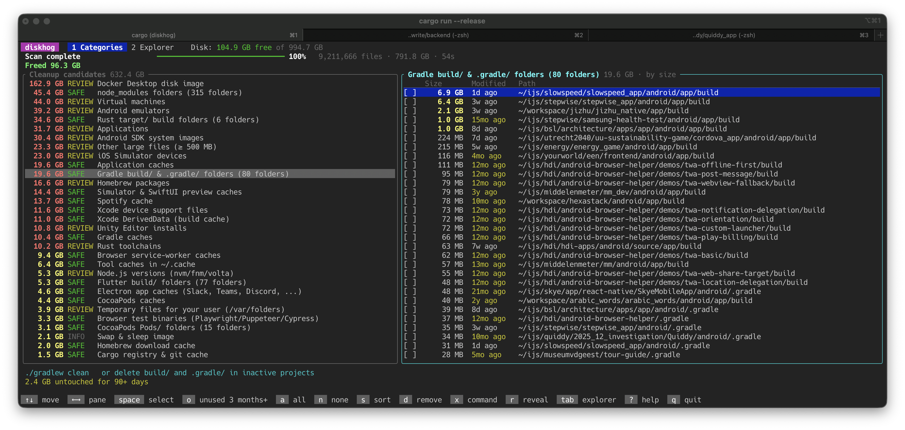

# diskhog

Find out where your disk space went and win it back, biggest wins first.



## Getting started

```bash
cargo install --path .     # or: cargo build --release && ./target/release/diskhog
diskhog                    # interactive full-screen UI
diskhog ~/projects         # only scan specific folders
diskhog --report           # print a static report instead (also used when piped)
```

## How it scans

Two walks run in parallel:

1. **Hotspots**: the ~60 places that usually hold reclaimable space (Docker, VMs,
   Xcode/Simulators, Android, package-manager caches, browser caches, …). These hold
   most of the bytes, so on a typical dev Mac ~40% of the disk and ~400 GB of
   candidates show up within ~6 seconds.
2. **Everything else**, looking for build artifacts anywhere (`node_modules`, Cargo
   `target/`, Unity `Library/`, Gradle/Flutter/CMake/SwiftPM builds, venvs, …), large
   files and leftover installers. It skips the hotspots and merges their sizes in at
   the end.

The progress % compares bytes scanned with what the previous run saw (the first run
uses the disk's used space). On macOS it lists directories with `getattrlistbulk`
(names and sizes for a whole directory in a few syscalls). It measures real on-disk
usage and counts hard links once.

## The UI

```
 diskhog   1 Categories  2 Explorer          Disk: 10.3 GB free of 994.7 GB
 Scanning…  ━━━━━━━━━━━━━━━━━━──────────  59%   2,476,225 files · 524 GB · 12s
╭ Cleanup candidates ─────────────────╮╭ node_modules folders (375) · oldest first ──╮
│ 162.9 GB REVIEW Docker disk image   ││[✓]  305 MB  3y ago   ~/ijs/mm_dev/node_modules │
│  61.1 GB SAFE   Rust target/ (22)   ││[✓]  232 MB  3y ago   ~/ijs/relay/node_modules  │
│  54.3 GB SAFE   node_modules (375) ✓││[ ]   10 GB  1d ago   ~/ijs/slowspeed/node_mod… │
```

- **Categories** (left), largest first, tagged `SAFE` (rebuilt automatically) or
  `REVIEW` (your data or installs). **Items** (right) show size and age: last
  modified, or for apps *last launched* (the access time of the app's executable).
- `o` selects everything unused for 3 months; press again for 6 months, 1 year, 2 years.
  `s` sorts by age, `space` toggles one item, `a`/`n` select all/none.
- `d` removes the selection: **t** moves it to the Trash, **D** deletes permanently.
  It runs in the background and the numbers update as items go.
- `x` runs a category's proper cleanup command (`docker system prune -a --volumes`,
  `npm cache clean --force`, `brew autoremove && brew cleanup`, `xcrun simctl delete
  unavailable`, …), then re-measures.
- `tab` switches to the **Explorer**, an ncdu-style folder browser that tags
  folders belonging to a cleanup category. `r` reveals the item in Finder. `?` shows help.

Items that shouldn't be deleted file-by-file (iCloud Drive, Photos, Docker's disk
image, Homebrew's Cellar, Simulator devices, Ollama blobs, …) are dimmed. Use the
shown advice or the `x` command for those. Build folders inside tool-managed places
(VS Code extensions, nvm, `~/Library`) are ignored, because they belong to the tool.

Grant your terminal **Full Disk Access** (System Settings › Privacy & Security) to
let it see Mail, Trash and other protected folders.

## Code

| File | What |
|---|---|
| `src/scan.rs` | parallel walker, hotspot + full walks, live shared state |
| `src/rules.rs` | the known space hogs, and grouping scan data into categories |
| `src/tui.rs` | the ratatui interface |
| `src/actions.rs` | Trash / delete jobs, app launch times |
| `src/report.rs` | the non-interactive report |
